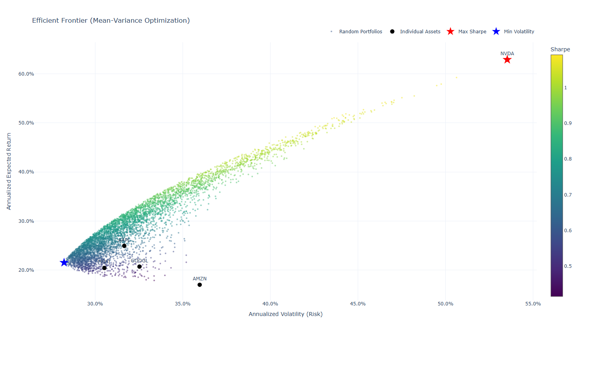
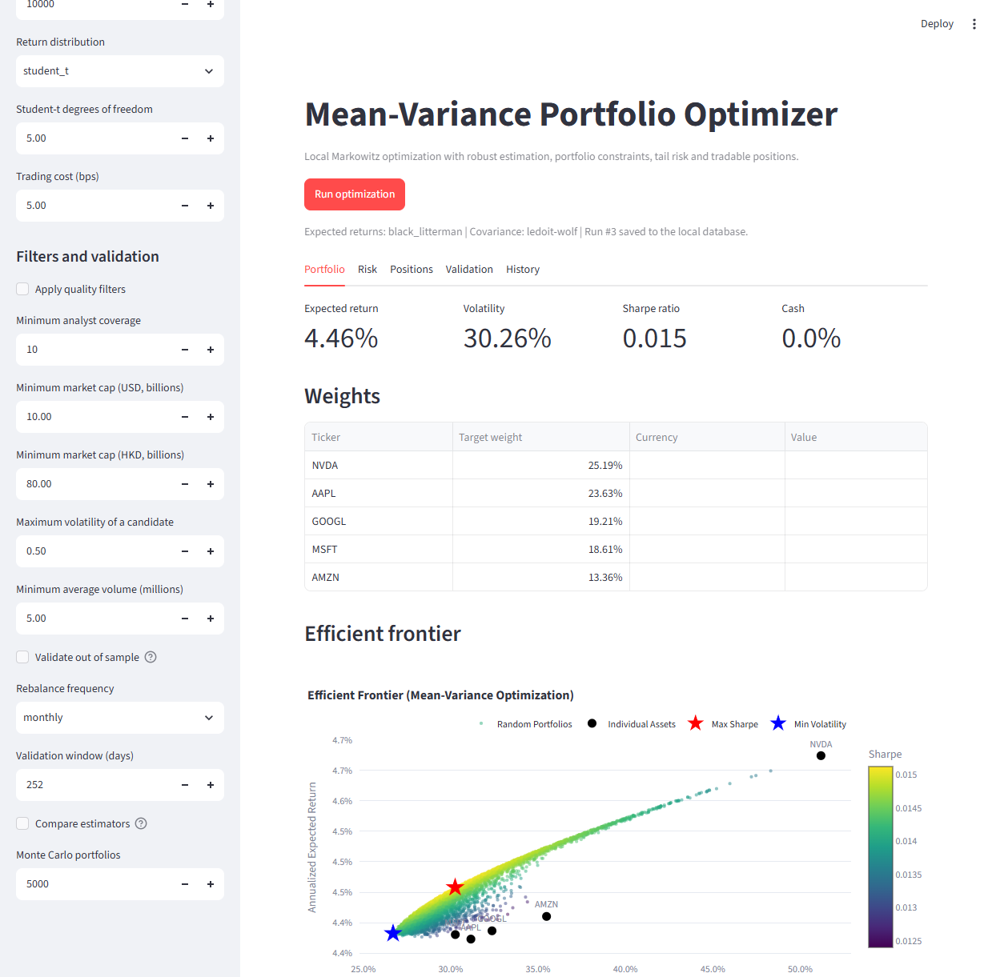

# mean-variance-optimizer

A fully local, deterministic Python implementation of Harry Markowitz's
Modern Portfolio Theory. Give it a list of tickers and a date range, and it
fetches free historical prices, computes annualized risk/return statistics, and
solves for the mathematically optimal long-only asset allocation that maximizes
the Sharpe ratio or minimizes volatility.

Everything runs natively on Windows: no cloud services, no API keys, no Docker,
no WSL, and no database server. The data source (`yfinance`) is free and
key-less, the store is a single local SQLite file, and the chart is a
self-contained HTML file you open by double-clicking.



*Monte Carlo portfolio cloud coloured by Sharpe ratio, with each asset plotted
individually and the optimal Max-Sharpe (red star) and Min-Volatility (blue
star) portfolios highlighted.*



*The same engine as a Streamlit app: the sidebar collects the universe, the
estimation method, the constraints and the risk settings, and the tabs show
the portfolio, the tail risk, the tradable positions, the out-of-sample
validation and the run history.*

## Running it

There are two front ends over the same pipeline. The app is the interactive
one; the command line is the scriptable one.

```powershell
.\.venv\Scripts\python.exe -m streamlit run app.py
```

The app opens on `http://localhost:8501`. It is a standalone project: it
shares nothing with any other application.

## Features

- **Deterministic Markowitz optimization** — classical convex optimization via
  `scipy.optimize` (SLSQP), with a fully invested constraint (`sum(w) = 1`) and
  long-only bounds (`0 <= w <= 1`). Both objectives are solved with an analytic
  gradient, which is faster and more reproducible than numerical differences.
  No machine learning, no heuristics.
- **Robust covariance estimation** — Ledoit-Wolf and OAS shrinkage estimators
  pull the noisy sample covariance towards a scaled identity matrix. This is
  the single biggest defence against the estimation error that makes plain
  mean-variance allocate everything to one asset.
- **Interchangeable expected-return estimators** — the default is `auto`, which
  uses a Black-Litterman posterior when market capitalizations are available
  and falls back to the sample mean of log returns when they are not. The
  capital asset pricing model is also available, and a Black-Litterman
  posterior can be built from absolute analyst views.
- **Measured, not assumed** — `--compare-estimators` walks every estimator
  forward out of sample and reports them side by side, so the choice of
  estimator is an empirical question rather than a matter of taste.
- **Quality filters** — companies that are too small, too thinly traded, too
  volatile or too poorly covered are excluded before the optimizer sees them,
  and the reason for every exclusion is reported. A missing field is not a
  failed field, so a company Yahoo Finance has no data for is not dropped by
  accident.
- **Analyst views, off by default** — consensus price targets can be used as
  Black-Litterman views, with a confidence you choose. Measured out of sample
  they did not improve the risk-adjusted return, so they stay opt-in.
- **Portfolio selection with mandatory holdings** — name the positions that must
  be in the portfolio and how many names to hold; a beam search finds the
  best subset and is checked against an exhaustive enumeration. A mandatory
  holding carries a minimum weight, so it cannot be satisfied in name only.
- **Multiple markets** — US and Hong Kong listings in one portfolio, with
  board lots, per-market currencies and market capitalizations converted into
  US dollars before they are added up.
- **Portfolio constraints** — minimum weights (how a mandatory core holding is
  expressed), a maximum weight per asset, and a maximum portfolio volatility.
  Infeasible requests are refused with a clear message instead of an obscure
  solver error.
- **Capital allocation to a target return** — scale the risky portfolio against
  the risk-free asset so the combined portfolio reaches a requested return. A
  target the tangency portfolio cannot reach is an error, not a label.
- **Out-of-sample validation** — a walk-forward backtest re-estimates the
  portfolio on a rolling window and reports its performance next to an
  equal-weight benchmark over the same periods.
- **Risk, not just volatility** — a Student-t simulation (fat-tailed, because
  financial returns have fat tails) turns the portfolio into a distribution of
  terminal values, so the loss at the 95% level, the expected loss in the
  worst 5% and the probability of profit are measured rather than assumed.
- **Tradable positions** — target weights become whole shares and whole board
  lots, the leftover cash is reported instead of silently disappearing, and a
  position too small for one board lot is called out.
- **Durable, versioned history** — every run is appended to a local SQLite
  database that is migrated in place, so the history survives an upgrade.
- **Two objectives** — maximize the Sharpe ratio or minimize portfolio variance;
  both are computed on every run and the chosen one is reported and persisted.
- **Efficient frontier visualization** — ~5,000 random long-only portfolios
  sampled from the probability simplex, exported as a standalone interactive
  Plotly HTML file with the Plotly JS bundle inlined (works offline).
- **Robust data handling** — mismatched trading calendars are aligned,
  internal gaps forward-filled, and leading gaps truncated to the common
  overlap with a warning.
- **Real-world edge cases handled** — zero-variance assets are detected and
  excluded, single-asset portfolios bypass the solver, and optimization
  failures raise a clear, custom error.
- **Durable local history** — every run is appended to
  `data/portfolio_history.db` (SQLite), including tickers, date range,
  objective, JSON weights, expected return, volatility, and Sharpe ratio.
- **Verified** — a `pytest` suite covers the math, the optimizer constraints,
  data cleaning, persistence, and the full CLI pipeline offline.

## Tech Stack

| Layer | Choice |
| --- | --- |
| Language | Python 3.14 (standard library `sqlite3`, `argparse`) |
| Data | `pandas`, `numpy` |
| Data source | `yfinance` (free, no API key) |
| Optimization | `scipy.optimize` (SLSQP, analytic gradients) |
| Covariance | `scikit-learn` (Ledoit-Wolf, OAS shrinkage) |
| Visualization | `plotly` (self-contained HTML export, and inline in the app) |
| Interface | `streamlit` (the app), `argparse` (the command line) |
| Persistence | SQLite (single local `.db` file) |
| Testing | `pytest` |

## Project Structure

```text
mean_variance_optimizer/
├── data/                     # Local SQLite database (gitignored)
│   └── portfolio_history.db
├── outputs/                  # Generated HTML charts (gitignored)
│   └── efficient_frontier_YYYYMMDD.html
├── docs/                     # README screenshots
│   ├── efficient_frontier.png
│   └── streamlit_app.png
├── src/
│   ├── __init__.py
│   ├── errors.py             # Shared exception hierarchy
│   ├── app_helpers.py        # Parsing and tables for the Streamlit app
│   ├── data_fetcher.py       # Fetch + clean prices, align calendars
│   ├── math_engine.py        # Log returns, annualized metrics, covariance
│   ├── covariance.py         # Sample / Ledoit-Wolf / OAS covariance
│   ├── expected_returns.py   # Historical mean, CAPM, Black-Litterman
│   ├── constraints.py        # Minimum weights, weight and volatility caps
│   ├── optimizer.py          # scipy SLSQP optimization + Monte Carlo sampler
│   ├── allocation.py         # Capital allocation line to a target return
│   ├── validation.py         # Walk-forward backtest vs equal weight
│   ├── market.py             # Listing currency, board lot, FX, market weights
│   ├── fundamentals.py       # Company fundamentals with an on-disk cache
│   ├── selection.py          # Portfolio selection with mandatory holdings
│   ├── analyst.py            # Analyst price targets as Black-Litterman views
│   ├── filters.py            # Quality rules for the candidate universe
│   ├── risk.py               # Tail risk: VaR, expected shortfall, profit odds
│   ├── sizing.py             # Whole shares, board lots, leftover cash
│   ├── database.py           # Local SQLite persistence, migrated in place
│   └── visualizer.py         # Plotly HTML chart generation
├── tests/
│   ├── test_math_engine.py
│   ├── test_optimizer.py
│   ├── test_app.py           # The Streamlit app, run through Streamlit's harness
│   ├── test_app_helpers.py
│   ├── test_covariance.py
│   ├── test_expected_returns.py
│   ├── test_constraints.py
│   ├── test_allocation.py
│   ├── test_validation.py
│   ├── test_market.py
│   ├── test_fundamentals.py
│   ├── test_selection.py
│   ├── test_analyst.py
│   ├── test_risk.py
│   ├── test_sizing.py
│   ├── test_data_fetcher.py
│   ├── test_database.py
│   ├── test_visualizer.py
│   └── test_main.py
├── main.py                   # CLI entry point / pipeline orchestration
├── app.py                    # Streamlit front end
├── requirements.txt
├── pytest.ini
└── README.md
```

## Installation (native Windows)

```powershell
git clone <repo>
cd mean_variance_optimizer
python -m venv .venv
.\.venv\Scripts\python.exe -m pip install -r requirements.txt
```

## Usage

Run the optimizer with a list of tickers and a date range:

```powershell
.\.venv\Scripts\python.exe main.py --tickers AAPL MSFT GOOGL --start 2020-01-01 --end 2024-12-31
```

Run with the minimum-volatility objective:

```powershell
.\.venv\Scripts\python.exe main.py --tickers AAPL MSFT GOOGL AMZN NVDA --objective min_vol
```

Force a core holding into the portfolio and cap single-asset concentration:

```powershell
.\.venv\Scripts\python.exe main.py --min-weight AAPL=0.25 --min-weight MSFT=0.15 --max-weight 0.30
```

Choose which assets to hold, with a mandatory holding that is always in:

```powershell
.\.venv\Scripts\python.exe main.py --tickers AAPL MSFT 0700.HK 0005.HK 9988.HK --fixed 0700.HK --max-k 3 --max-weight 0.40
```

Target a return and hold the rest in the risk-free asset:

```powershell
.\.venv\Scripts\python.exe main.py --target-return 0.12
```

Size a real portfolio and see its tail risk:

```powershell
.\.venv\Scripts\python.exe main.py --budget 100000 --fee-bps 5
```

Check the result out of sample against an equal-weight benchmark:

```powershell
.\.venv\Scripts\python.exe main.py --validate --validate-rebalance monthly
```

The same thing through the app, with the results in the browser:

```powershell
.\.venv\Scripts\python.exe -m streamlit run app.py
```

Or just run it with no arguments for a sensible default universe:

```powershell
.\.venv\Scripts\python.exe main.py
```

| Flag | Default | Description |
| --- | --- | --- |
| `--tickers` | `AAPL MSFT GOOGL AMZN NVDA` | Ticker symbols to optimize |
| `--start` | `2020-01-01` | Inclusive start date (`YYYY-MM-DD`) |
| `--end` | today | Inclusive end date (`YYYY-MM-DD`) |
| `--objective` | `max_sharpe` | `max_sharpe` or `min_vol` |
| `--risk-free-rate` | `0.04` | Annualized risk-free rate |
| `--db-path` | `data/portfolio_history.db` | SQLite database path |
| `--output-dir` | `outputs` | Directory for the HTML chart |
| `--portfolios` | `5000` | Monte Carlo portfolios to sample |
| `--expected-return-method` | `auto` | `auto`, `historical_mean`, `capm` or `black_litterman` |
| `--covariance-method` | `ledoit-wolf` | `sample`, `ledoit-wolf` or `oas` |
| `--market-index` | `^GSPC` | Market index used by the CAPM estimator |
| `--market-risk-premium` | `0.05` | Risk premium scaling the Black-Litterman equilibrium |
| `--tau` | `0.05` | Uncertainty of the Black-Litterman prior |
| `--fundamentals-cache` | `data/fundamentals_cache.json` | Where raw fundamentals are cached |
| `--refresh-fundamentals` | off | Ignore the fundamentals cache and fetch again |
| `--market-meta` | – | CSV overriding the built-in market metadata |
| `--usd-hkd` | `7.82` | Hong Kong dollars per US dollar |
| `--min-weight` | – | Minimum weight per ticker, e.g. `AAPL=0.25`; repeatable |
| `--fixed` | – | A holding that must be in the portfolio; repeatable |
| `--max-k` | `0` | Maximum number of assets to hold; 0 keeps the whole universe |
| `--selection-beam` | `5` | Partial selections the search keeps per step |
| `--quality-filters` | off | Exclude companies that fail the quality rules |
| `--min-analyst-count` | `10` | Minimum analyst coverage |
| `--min-market-cap-usd` | `10000000000` | Minimum market cap for US listings |
| `--min-market-cap-hkd` | `80000000000` | Minimum market cap for Hong Kong listings |
| `--filter-max-volatility` | `0.5` | Maximum annualized volatility of a candidate |
| `--min-avg-volume` | `5000000` | Minimum average daily share volume |
| `--analyst-views` | off | Use analyst price targets as Black-Litterman views |
| `--analyst-confidence` | `0.15` | How much of the analyst view is believed |
| `--max-weight` | – | Maximum weight for any single ticker, e.g. `0.35` |
| `--max-volatility` | – | Maximum annualized portfolio volatility, e.g. `0.15` |
| `--target-return` | – | Annualized return to reach; the rest is held in cash |
| `--budget` | – | Amount to invest; enables the risk simulation and position sizing |
| `--simulations` | `10000` | Simulated paths in the risk simulation |
| `--risk-distribution` | `student_t` | `student_t` or `bootstrap` |
| `--student-t-df` | `5` | Degrees of freedom of the Student-t shocks |
| `--fee-bps` | `0` | One-way trading cost in basis points |
| `--validate` | off | Run the out-of-sample walk-forward backtest |
| `--validate-window` | `252` | Observations required before the first rebalance |
| `--validate-rebalance` | `monthly` | `monthly` or `quarterly` |
| `--compare-estimators` | off | Walk-forward every estimator and compare the results |

After a run, double-click the generated
`outputs/efficient_frontier_YYYYMMDD.html` to explore the frontier in your
browser. No web server is required.

## How It Works

1. **Data ingestion** — daily adjusted close prices are downloaded per ticker
   (`auto_adjust=True`, so `Close` is the adjusted series). Trading calendars
   are aligned across assets.
2. **Cleaning** — internal gaps are forward-filled; leading rows where any
   asset has not started trading are dropped, which truncates the range to the
   common overlap and emits a warning.
3. **Financial math** — daily **log returns** `ln(P_t / P_{t-1})` are computed,
   then annualized over a fixed **252-trading-day** year:
   - expected return = mean daily log return x 252
   - covariance = shrinkage estimator applied to the daily covariance, x 252
4. **Selection** — when `--max-k` is set, a beam search grows the portfolio
   one asset at a time, keeping the most promising partial selections. The
   mandatory holdings are part of the portfolio from the first step and
   carry a minimum weight.
5. **Optimization** — SLSQP minimizes `-(Sharpe)` or portfolio variance subject
   to `sum(w) = 1` and `0 <= w <= 1`, where
   `Sharpe = (E[r] - r_f) / sigma` and `sigma = sqrt(wᵀ Σ w)`. Minimum weights
   are substituted out (`w_i = m_i + u_i`) so the solver always works on
   interior variables, and a volatility cap is passed as a nonlinear
   constraint.
6. **Capital allocation** — when a target return is requested, the tangency
   portfolio is scaled against the risk-free asset along the capital
   allocation line.
7. **Risk simulation** — when a budget is given, the portfolio is simulated
   over a year with fat-tailed daily shocks (or by resampling its own
   history), and the loss at the 95% level, the expected loss in the worst 5%
   and the probability of profit are read off the distribution.
8. **Position sizing** — the target weights become whole shares and whole
   board lots. The leftover cash is reported, and a position too small for
   one board lot is called out instead of silently vanishing.
9. **Persistence** — the run, its risk metrics and its positions are appended
   to the local SQLite database.
10. **Visualization** — 5,000 random long-only portfolios (Dirichlet-sampled,
    so weights always sum to 1) are plotted as a cloud coloured by Sharpe
    ratio, alongside the assets and both optimal portfolios. The capital
    allocation line and the distribution of terminal values are added when
    they are available.
11. **Validation** (optional) — the portfolio is re-estimated on a rolling
    window and applied to the period that follows, then compared with an
    equal-weight benchmark over the same periods.

### Expected-Return Estimators

```
Historical mean : mu_i = mean(daily log return) x 252

CAPM            : mu_i = r_f + beta_i x (E[R_m] - r_f)
                  beta_i = cov(r_i, R_m) / var(R_m)

Black-Litterman : prior  pi = r_f + delta x Sigma x w_market
                  posterior = [(tau Sigma)^-1 + P' Omega^-1 P]^-1
                              [(tau Sigma)^-1 pi + P' Omega^-1 Q]
```

A view confidence `theta` in `(0, 1)` controls how far the posterior moves
towards the view: `0.5` splits the difference evenly, `0.95` moves it 95% of
the way, and `theta -> 0` leaves the prior untouched.

Without views, the Black-Litterman prior already says something useful: the
expected returns stop being each asset's own noisy history and become the
market's implied equilibrium, which differ between assets only through their
covariance with the market portfolio. That is why a Black-Litterman run
produces a diversified, minimum-volatility-looking portfolio -- the
differentiation between assets comes from the views.

### Which Estimator Should I Use?

Run the comparison on your own universe and period rather than trusting a
table from someone else:

```powershell
.\.venv\Scripts\python.exe main.py --tickers AAPL MSFT GOOGL AMZN --compare-estimators
```

Three reference runs on this machine, each reported out of sample against an
equal-weight benchmark over the same periods:

| Universe | Period | `historical_mean` | `capm` | `black_litterman` | Benchmark |
| --- | --- | --- | --- | --- | --- |
| 4 mega caps | 2022-2024 | Sharpe 1.27 | Sharpe 2.22 | Sharpe 2.22 | Sharpe 2.26 |
| 10 large caps | 2015-2024 | Sharpe 1.42, DD -51% | Sharpe 1.10 | Sharpe 1.43 | Sharpe 1.30 |
| 8 mixed caps | 2010-2024 | Sharpe 0.91 | Sharpe 0.86 | Sharpe 1.08 | Sharpe 1.01 |

The sample mean of history was the weakest of the three and the most
volatile, and it lost to the benchmark outright in two of the three runs.
Black-Litterman beat the benchmark in two runs and came close in the third,
and it never produced the worst drawdown, which is why it is the default.
CAPM was the least consistent. These are three runs, not a proof -- the
comparison is the point, not the table.

The Black-Litterman rows use today's market capitalizations for every
historical period, so their backtest is mildly optimistic. The other two
rows are not.

Analyst price targets, used as Black-Litterman views with a confidence of
0.15, made the risk-adjusted result **worse** in all three runs (Sharpe
2.07 -> 1.76, 1.43 -> 1.35, 1.06 -> 0.89). Consensus targets are
optimistic and follow momentum, and the portfolio pays for chasing them.
They are therefore opt-in.

One caveat on all of these numbers: the optimizer is deterministic, but the
data source is not perfectly so. Yahoo Finance occasionally serves slightly
different adjusted prices or a shorter history, which moves the reported
figures by a percent or two. Re-run the comparison to see the numbers for
the data you actually got.

### Covariance Estimation

```python
# Ledoit-Wolf shrinkage for numerical stability
Sigma = shrunk_covariance(log_returns, method="ledoit-wolf")  # x 252

# Positive-definiteness guard
ensure_positive_semidefinite(Sigma)
```

The shrinkage estimators are fitted on **daily** returns, which is the
frequency they expect, and the result is annualized afterwards.

## Outputs

- `data/portfolio_history.db` — one row per run (`Run_ID`, `Tickers`,
  `Date_Range`, `Objective_Used`, `Optimal_Weights` as JSON, `Expected_Return`,
  `Expected_Volatility`, `Sharpe_Ratio`, `Risk_Free_Rate`, `Cash_Weight`,
  `Target_Return`, `Expected_Return_Method`, `Covariance_Method`, `VAR_95`,
  `CVAR_95`, `Prob_Profit`, `Estimated_Cost`, `Created_At`), plus one row per
  position in the `positions` table.
- `outputs/efficient_frontier_YYYYMMDD.html` — self-contained interactive chart.

Inspect stored history at any time:

```powershell
.\.venv\Scripts\python.exe -c "from src.database import fetch_runs; [print(r['Run_ID'], r['Objective_Used'], r['weights']) for r in fetch_runs('data/portfolio_history.db')]"
```

## Testing

```powershell
.\.venv\Scripts\python.exe -m pytest
```

The suite runs entirely offline: the yfinance network boundary is injected, so
no test ever downloads data.

## Robustness & Edge Cases

| Case | Behaviour |
| --- | --- |
| Zero-variance asset (price never moves) | Detected and excluded before optimization, with a warning |
| Asset with insufficient history | Range truncated to the common overlap, with a warning |
| Single-asset portfolio | Solver bypassed; returns weight `1.0` |
| Empty / failed download | Raises `DataFetchError` with a clear message |
| All assets excluded / unusable | Raises `DataFetchError` |
| Singular or indefinite covariance | Raises `OptimizationError` |
| Solver fails to converge | Raises `OptimizationError` |
| Minimum weights that cannot be invested | Raises `ConstraintError` |
| Maximum weight too small to invest fully | Raises `ConstraintError` |
| Volatility cap that cannot be met | Raises `OptimizationError` |
| Target return above the tangency return | Raises `AllocationError` |
| Target return below the risk-free rate | Raises `AllocationError` |
| Not enough history for a validation window | Raises `OptimizationError` |

## Limitations

- Local research tool only: no live trading, broker integration, or order
  execution.
- Unconstrained mean-variance is still sensitive to expected-return estimation
  error. Shrinkage, weight caps and a risk-free sleeve reduce the damage, but
  the out-of-sample comparison against an equal-weight benchmark is the only
  honest way to judge a given universe — and the optimized portfolio does not
  win that comparison on every dataset.
- Expected returns are estimated from historical means, which is a noisy
  estimator; treat the output as an illustration of the method, not investment
  advice.
- The Black-Litterman market portfolio is the capitalization-weighted
  candidate universe, not a broad market index, and the backtest uses today's
  capitalizations for every historical period, so it is mildly optimistic.
- Fundamentals come from a free, unofficial source and can be wrong. They are
  cached for 24 hours; pass `--refresh-fundamentals` to fetch them again.
- Long-only portfolios. Leverage, short selling and derivative overlays are out
  of scope.
- Position sizing uses the latest prices, while the weights come from the
  historical window, so a position can be too small for one board lot. That is
  reported rather than rounded away, and the money stays in cash.
- The risk simulation assumes the portfolio's behaviour over the next year
  resembles its history; it is a description of the shape of the risk, not a
  forecast.
- Prices come from a free, unofficial data source and can be wrong. It is
  also not perfectly stable between calls, so two runs a day apart may report
  slightly different figures.
- The quality rules are opinionated and only apply when `--quality-filters` is
  given: the default thresholds exclude a lot of perfectly good companies.
- Analyst price targets are consensus expectations, which are optimistic and
  momentum-driven. They are available as views but off by default.

## Notes

- `data/` and `outputs/` are gitignored; only source, tests, and the README
  screenshot are committed.
- `pytest.ini` sets `pythonpath = .` so `tests/` can import both `src.*` and
  the root `main.py`.
- The default covariance estimator is `ledoit-wolf`, which changes the
  weights compared with an earlier plain sample-covariance release. Pass
  `--covariance-method sample` to reproduce the old behaviour.
- The default expected-return estimator is `auto`, which uses Black-Litterman
  when market capitalizations are available and the historical mean otherwise.
  The report always names the estimator it actually used, and a fallback
  prints a warning.
